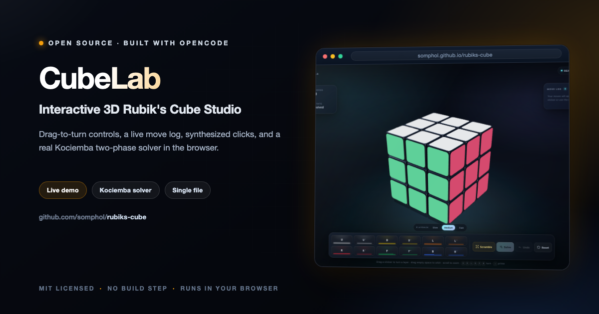

<div align="center">



# CubeLab

**Interactive 3D Rubik's Cube Studio**

Drag-to-turn controls, a live move log, synthesized mechanical clicks, and a real Kociemba two-phase solver in the browser.

[](https://somphol.github.io/rubiks-cube/)
[](LICENSE)

**[Try it live →](https://somphol.github.io/rubiks-cube/)**

</div>

---

## Highlights

- **26-cubelet 3D cube** built with Three.js, rounded bevels, glossy stickers, soft studio lighting, shadows, and a dark slate gradient stage.
- **Direct manipulation** — raycast a sticker and drag to turn that row or column. Drag empty space to orbit 360°, scroll or pinch to zoom. Middle rows turn the M / E / S slices.
- **Full control dock** — U, U′, D, D′, L, L′, R, R′, F, F′, B, B′ buttons plus keyboard shortcuts.
- **Scramble** — 20 randomized, non-redundant face turns with fast animated playback.
- **Solve** — computes a real solution from the current cube state with Herbert Kociemba's two-phase algorithm, then plays it back step by step. Solutions are typically 20 moves or fewer.
- **Solver in a worker** — the first solve warms up the pruning tables off the main thread, so the UI keeps animating. A main-thread fallback keeps the solver working in browsers that block Blob workers.
- **Playback controls** — Slow, Medium, and Fast speeds, plus pause/resume.
- **Live HUD** — timer, move count, personal best, solve state, and a scrollable move-history log with copy-to-clipboard.
- **Undo & reset** — reverse the last move or snap back to the pristine solved state.
- **Synthesized audio** — Web Audio API plastic clicks and a victory chime. No audio files.
- **Victory celebration** — 3D confetti, a celebratory camera orbit, and a results card with time, moves, and best.
- **Responsive** — the camera refits for portrait screens, and the dock rearranges for phones.

## Run it

### Locally

```bash
open index.html
```

Or serve the folder if you prefer HTTP:

```bash
python3 -m http.server 8000
# then visit http://localhost:8000
```

### Online

If GitHub Pages is enabled for this repository:

**https://somphol.github.io/rubiks-cube/**

## Controls

| Action | Input |
| --- | --- |
| Turn a layer | Drag a sticker in the direction the row/column should move |
| Orbit the camera | Drag empty space around the cube |
| Zoom | Scroll or pinch |
| Face turns | `U` `D` `L` `R` `F` `B` |
| Prime turns | Hold `Shift` while pressing a face key |
| Undo | `Z` |
| Pause / resume playback | `Space` |
| Close a dialog | `Esc` |

The on-screen dock also exposes every face turn, Scramble, Solve, Undo, and Reset.

## How the solver works

The logical cube is modelled with [cube.js](https://github.com/ldez/cubejs), an MIT-licensed implementation of Kociemba's two-phase algorithm. The visual cube and the logical cube are kept in sync by applying the same move definitions to both; the app includes a self-test that verifies all 18 face turns, all 9 slice turns, and a full solver run.

On the first solve:

1. The solver tables are computed in a Blob Web Worker.
2. The current cube state is sent to the worker as a facelet string.
3. The worker returns a solution in standard notation.
4. The main thread plays each move with the same easing and audio used for manual turns.

If Blob workers are unavailable (for example, some `file://` browser configurations), CubeLab falls back to initializing the solver on the main thread behind the loading overlay.

## Project layout

```
.
├── index.html                 # built, self-contained playable app
├── preview.png                # README screenshot
├── build.py                   # assembles index.html from src/
├── src/
│   ├── index.template.html    # HTML shell + UI markup
│   ├── styles.css             # glass UI, responsive layout, animations
│   ├── app.js                 # Three.js scene, cube mechanics, UI logic
│   └── vendor/
│       ├── cube.min.js        # cube.js model (MIT)
│       └── solve.js           # Kociemba two-phase solver (MIT)
├── LICENSE                    # MIT
└── THIRD_PARTY_NOTICES.md
```

## Development

Edit files in `src/`, then rebuild:

```bash
python3 build.py
```

The build inlines `src/styles.css`, `src/vendor/cube.min.js`, `src/vendor/solve.js`, and `src/app.js` into `index.html`.

There is also a browser self-test:

```text
index.html?selftest
```

It checks every face and slice move against the visual cube, validates the drag-direction mapping, solves a mixed state, and writes a pass/fail report to the page. Add `?debug` for a small `window.__cubeLab` inspection API, and `?noworker` to exercise the main-thread solver fallback.

## Technical notes

- **Three.js r128** via jsDelivr, with `OrbitControls` and `RoundedBoxGeometry` from the matching examples.
- **No external audio or image assets** — the environment map, favicon, glow, and confetti are generated at runtime.
- **Preferences** — sound, playback speed, and personal best are stored in `localStorage`.
- **Single file** — the generated `index.html` contains the UI, styles, cube model, solver, and app logic. Three.js is the only runtime CDN dependency, as requested.

## License

Project code: MIT © 2026 Somphol Boonjing.

Bundled [cube.js](https://github.com/ldez/cubejs) is MIT © Petri Lehtinen and Ludovic Fernandez. [Three.js](https://threejs.org/) is MIT © three.js authors. See [THIRD_PARTY_NOTICES.md](THIRD_PARTY_NOTICES.md).
